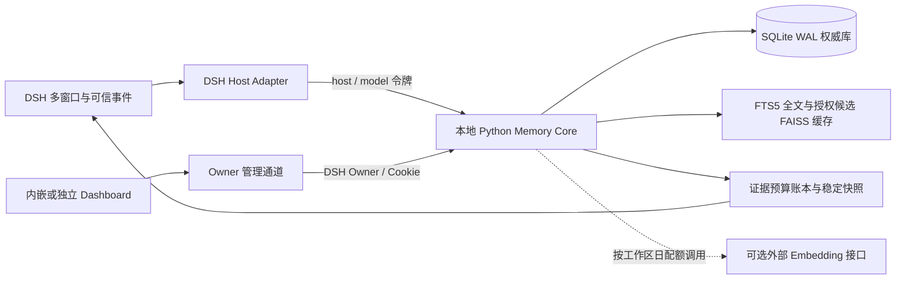

<div align="center">


# Memory Framework for DeepSeek Harness `0.3.2`

**专供 [DeepSeek Harness (DSH)](https://github.com/deepseek-ai/deepseek-harness) 使用的原生长期记忆、可追溯证据与跨窗口任务状态管理插件**

[](https://www.python.org/)
[](./LICENSE)
[](https://github.com/lingrs-LLM-researchTeam/Memory_FrameWork/releases)
[](https://github.com/deepseek-ai/deepseek-harness)
[](https://nodejs.org/)

- [介绍](#introduce)
- [安装与快速启动](#installation)
- [配置、预算与收录策略](#configuration)
- [功能面板、工具与排查](#usage)
- [模块架构与接口](#architecture)
- [Token 消耗、上下文预算与缓存命中率说明](#llm-usage)
- [开发、构建与验证](#development)
- [保留文档与来源说明](#documentation)

</div>

---

> [!IMPORTANT]
> **宿主平台专属声明**：本仓库当前版本（`v0.3.2`）为**专供 DeepSeek Harness (DSH) 使用的原生插件与独立 Python 记忆核心**，运行过程完全不依赖 AstrBot。
> 原先面向 QQ 群聊采集、好感度、黑话、人格学习、社交图谱及 AstrBot WebUI 的实现已独立拆分并迁入同级 **AstrBot_Memory_Framework** 仓库维护；两端仅共享不依赖宿主的纯检索融合与证据校验算法副本（`memory_framework_shared`），以便各自独立打包与安装。

<a id="introduce"></a>

## 介绍

本插件旨在解决在 **DeepSeek Harness (DSH)** 中开展长程开发与跨窗口协作任务时，多会话切换导致任务目标丢失、硬约束被压缩遗忘、跨窗口上下文污染，以及缺乏原始证据核验导致模型幻觉的问题。

插件由 **DSH 原生 Host/Client 适配器（TypeScript + React Dashboard）** 与 **本地权威记忆核心（Python + FastAPI + SQLite WAL + FTS5/FAISS）** 组成，通过有界上下文注入与受控记忆工具，让多个对话窗口共享同一套可追溯的事实、决策与任务验收状态。

> [!NOTE]
> **关于 Token 使用量与缓存命中率的提示**：启用本插件后，系统会在每轮对话准入阶段按预算注入当前关联任务的硬约束契约与高相关度长期记忆（`<memory-framework-context>`），同时允许模型在任务执行期间按需调用 `memory_framework_search`、`memory_framework_read`、`memory_framework_task_update` 等记忆与任务工具。因此，相比未挂载记忆插件的纯对话，**本插件会导致单轮 Token 使用量有所增加，且在跨轮次动态召回记忆或任务状态发生变更时，可能会导致模型服务端的 KV Cache（前缀缓存）命中率出现小幅度下降**。详细预算上限与缓存优化机制见 [Token 消耗、上下文预算与缓存命中率说明](#llm-usage)。

### 核心设计流

~~~text
来自 DSH 的可信事件（session/event · turn/start · agent/pre-step）
 -> 工作区与会话映射 + 工具收录策略过滤（默认仅保留原始证据）
 -> SQLite 事务：权威原文（sources）去重/修订 + 哈希记录 + 记忆派生
 -> 异步后台索引：jieba 中文分词扩展 + FTS5 词法索引 + 可选外部 Embedding / 内存 FAISS 缓存

模型步骤准入（agent/pre-step）或记忆工具调用
 -> 同步当前窗口真实路由容量（ctx.llm.resolveModelInfo）与输出保留量
 -> 服务端校验已暴露来源有效性（若含已撤销/缩权证据则阻断并要求干净接续）
 -> 授权范围过滤（session / task / workspace / selected / global）
 -> 词法 BM25 + 向量检索 -> RRF 融合 + 六维权重重排 + 冗余惩罚
 -> 稳定快照签名校验（未变化则复用同一回执文本）+ 每轮证据字节预算裁剪
 -> 注入 <memory-framework-context> / 返回带来源引用的分页证据
~~~

### 核心数据记录模型

本地 SQLite 权威数据库（Schema v3）维护以下核心记录：

| 记录表 | 关键字段 | 职责与安全边界 |
|---|---|---|
| `workspaces` / `sessions` | `id`, `instance_id`, `workspace_id`, `task_id`, `cursor`, `subscribed` | 工作区与会话隔离单元、任务绑定状态、事件游标及广播订阅开关 |
| `sources` | `id`, `session_id`, `event_id`, `role`, `content`, `content_hash`, `revision`, `status`, `promoted` | 权威原始消息与工具输出证据，按可信事件去重，单条上限 200,000 字符 |
| `memories` | `id`, `workspace_id`, `session_id`, `task_id`, `content`, `scope`, `targets`, `importance`, `pinned`, `status`, `vector_enabled`, `revision` | 可追溯的事实、约束或决策，支持五级可见范围与乐观并发修订控制 |
| `memory_sources` | `memory_id`, `source_id`, `quote` | 记忆与原始证据的多对多绑定；`quote` 须为原文逐字子串 |
| `tasks` / `task_events` | `id`, `workspace_id`, `title`, `goal`, `constraints`, `acceptance`, `verification`, `next_action`, `blockers`, `status`, `revision` | 跨窗口共享的长程任务契约、验收条件、检查点与版本历史 |
| `session_memory_exposures` / `session_fences` | `session_id`, `memory_id`, `receipt_id`, `reason` | 记录各会话已暴露的记忆与来源版本；来源撤销或缩权后触发会话隔离栅栏 |
| `session_context` / `session_snapshots` | `session_id`, `provider`, `model`, `context_window`, `max_output_tokens`, `signature`, `receipt_id` | 宿主模型容量准入报告与跨轮次稳定快照缓存 |
| `workspace_policies` / `evidence_usage` | `workspace_id`, `settings`, `turn_sequence`, `used_bytes`, `tool_calls`, `writes` | 工作区预算策略、单调递增轮次序号与每轮证据消耗账本 |
| `vectors` / `embedding_daily_usage` | `memory_id`, `fingerprint`, `vector`, `day`, `input_chars`, `calls` | 绑定模型指纹的归一化向量存储及按 UTC 日持久化的向量字符消耗账本 |

### 记忆状态与六维重排公式

记忆条目（`memories.status`）与来源关联遵循严格的状态演进：
- **`active`**：记忆处于有效状态，且关联的原始证据（`sources`）有效。
- **`archived`**：已归档记忆，不参与默认主动注入，可在面板随时恢复。
- **`quarantined`**：当记忆所依赖的任一原始来源被管理员执行撤销（`source.revoke`）时，派生记忆自动进入证据失效隔离态，且已暴露过该记忆的会话将被要求建立**干净接续会话（Clean Handoff）**。
- **`deleted`**：软删除状态，退出检索与上下文注入，保留审计历史。

在通过访问范围（Scope）硬过滤与证据有效性检查后，候选记忆按以下六维归一化加权公式与冗余惩罚进行重排：

~~~text
score = w_task * task_match
      + w_lexical * lexical_rrf
      + w_semantic * semantic_rrf
      + w_importance * importance
      + w_recency * exp(-ln(2) * age_days / half_life_days)
      + w_Pinned * pinned_flag
      - redundancy_penalty * max_token_overlap_with_selected
~~~

其中访问范围（`session` / `task` / `workspace` / `selected` / `global`）、证据撤销与任务硬约束**始终优先于排序权重**；排序权重仅影响已授权候选集内的先后次序，绝不扩大可见范围。

---

<a id="installation"></a>

## 安装与快速启动

**兼容基线**：DeepSeek Harness `0.2.2-rc.1`、Node.js `>=24.9.0`、Python `>=3.12`。
本方案面向单个本地所有者的多窗口协作场景；未配置外部 Embedding 时默认使用 `jieba` 扩展中文分词 + SQLite FTS5 全文检索，开箱即用。

### 1. 安装 DSH 原生插件（自动随 DSH 启动）

无需提前手动启动后端脚本。支持以下两种安装方式：

- **方式 A：在 DSH 桌面端通过 Git 仓库直接添加（推荐）**
  在 DSH 左侧栏点击「插件」→「添加插件」，直接粘贴仓库地址并安装：
  `https://github.com/lingrs-LLM-researchTeam/dsh-Memory_FrameWork`
- **方式 B：命令行安装（Git 仓库或本地 `.tgz` 发行包）**

```powershell
# 直接从 GitHub 仓库安装
npx @deepseek-ai/dsh@0.2.2-rc.1 plugin --profile web add "https://github.com/lingrs-LLM-researchTeam/dsh-Memory_FrameWork"

# 或从本地构建的发行包安装
npx @deepseek-ai/dsh@0.2.2-rc.1 plugin --profile web add "file:./dsh-memory-framework-0.3.2.tgz"
```

### 2. 启动 DSH 即可自动运行

直接启动或重载 DeepSeek Harness：
- **首次启动自动初始化**：插件内置了 Python 记忆核心组件包，会在 DSH 启动时自动检测并在 `~/.memory-framework/runtime` 下创建独立虚拟环境、安装核心依赖，同时自动初始化生成 `~/.memory-framework/credentials.json`（在 Windows 下自动通过 `icacls` 收紧为仅当前用户与 `SYSTEM` 可读）。
- **后台守护进程自启与生命周期托管**：插件会自动在后台拉起本地记忆核心服务（默认监听 `http://127.0.0.1:18765`），并在 DSH 退出或卸载插件时自动回收子进程；多窗口或多实例并发启动时会自动复用已运行的本地核心。
- **打开面板**：在 DSH 右侧面板入口点击 **「Memory Framework · 记忆与任务」** 即可直接使用（DSH 内嵌面板通过宿主 `owner` 身份鉴权，无需手动输入令牌）。

> [!TIP]
> **可选独立模式**：若希望在不启动 DSH 的情况下单独浏览或维护记忆库，仍可在发行包解压目录运行 `./start.ps1` 手动启动核心，并通过浏览器访问 `http://127.0.0.1:18765`（使用 `~/.memory-framework/credentials.json` 中的 `admin_token` 登录独立版 Dashboard）。

---

<a id="configuration"></a>

## 配置、预算与收录策略

### 宿主插件配置项

| 配置键 | 默认值 | 说明 |
|---|---|---|
| `coreUrl` | `http://127.0.0.1:18765` | 本地 Python 记忆核心监听地址（仅限本机 `127.0.0.1` / `localhost` / `::1`） |
| `instanceId` | `dsh-default` | 实例标识。同一 Profile 下的多个窗口应保持相同值；不同 Profile 共用同一核心时请配置不同且稳定的 `instanceId` |
| `credentialsFile` | `~/.memory-framework/credentials.json` | 宿主本地凭据文件路径（服务端读取，非浏览器 URL） |
| `autoStartCore` | `true` | 启动 DSH 时自动检测、初始化并在后台拉起本地 Python 记忆核心守护进程 |
| `pythonCommand` | `""` | 可选自定义 Python `>=3.12` 可执行文件路径（留空时自动探测系统 Python） |
| `projectGoals` | `false` | 开启且宿主加载 Goal 模块时，将任务目标单向投影至会话 Goal（新建投影立即 `disarm`，不授予自动续跑权限，也不覆盖人工编辑的 Goal） |

### 工作区预算与收录策略（Dashboard「预算与收录」）

每个工作区均可独立配置以下配额与采集策略（保存时执行 `expected_revision` 乐观锁校验，防止多窗口覆盖）：

| 策略字段 | 默认值 | 范围 | 作用与行为 |
|---|---:|---:|---|
| `context_mode` | `follow_dsh` | `follow_dsh` / `manual` | 默认跟随当前对话窗口所选模型的上下文容量；未知容量或 `manual` 时使用下方固定字节上限 |
| `context_share` | `10` (%) | `1` – `20` (%) | 跟随模式下，扣除模型输出上限后分配给自动记忆注入的窗口占比 |
| `evidence_bytes` | `32,000` B | `4,000` – `256,000` B | 手动/未知容量模式下每轮总证据预算（自动注入 + 工具读取/搜索共享） |
| `automatic_bytes` | `12,000` B | `1,000` – `128,000` B | 手动/未知容量模式下每轮自动注入上限（须为工具预留至少 `2,000` B 差额） |
| `max_tool_calls` | `12` 次 | `1` – `50` 次 | 单轮允许模型调用记忆与任务工具的最大次数 |
| `max_writes` | `3` 次 | `0` – `20` 次 | 单轮允许模型执行记忆写入或任务状态更新的最大次数 |
| `source_chars` | `2,000` 字符 | `100` – `12,000` 字符 | `memory_framework_read` 每次分页读取原始证据的最大字符数 |
| `tool_memory_mode` | `evidence_only` | `evidence_only` / `allowlist` / `all` | 工具输出收录模式：默认仅保存原始证据待人工挑选，避免工具输出刷屏污染记忆库 |
| `tool_max_chars` | `4,000` 字符 | `100` – `12,000` 字符 | 开启自动收录工具输出时的单条字符上限（超长、报错或同任务重复输出默认跳过） |
| `embedding_daily_chars` | `200,000` 字符 | `1,000` – `10,000,000` 字符 | 工作区每日（UTC）向量化输入字符硬上限（查询与建索引共享，失败尝试亦计入） |

### 可选外部向量模型（OpenAI-Compatible Embedding）

核心支持接入兼容 OpenAI `/v1/embeddings` 协议的向量服务。在启动核心前设置环境变量即可启用词法 + 向量混合检索：

```powershell
$env:MEMORY_EMBEDDING_URL = 'https://your-provider.example/v1/embeddings'
$env:MEMORY_EMBEDDING_MODEL = 'your-embedding-model'
$env:MEMORY_EMBEDDING_KEY = '<YOUR_API_KEY>'
$env:MEMORY_EMBEDDING_REVISION = '1'
$env:MEMORY_EMBEDDING_DIMENSIONS = '1024'
```

模型指纹由 `URL | Model | Revision | Dimensions` 共同构成，防止不同语义空间的向量混用。后台建索引采用指数退避（单条失败最长退避 1 小时），查询具备 5 分钟 / 128 条 LRU 缓存与并发锁合并；未配置或暂停向量化时自动平滑回退至全文检索。

---

<a id="usage"></a>

> 0.3.2 修复与 其他记忆插件潜在的同名工具调用风险，但是仍不能保证完全规避了这种情况，因此相当不建议您同时将此插件与其他插件进行加载。Memory Framework 的工具目前统一修改为使用 `memory_framework_*` 前缀来规避同名的情况。


## 功能面板、工具与排查

### Dashboard 六大视图

Dashboard 采用受 Moonshot AI 启发的高反差极简黑白（**夜墨 Ink / 纸白 Paper**）设计语言，纯原生 CSS 驱动，面板不可见时自动挂起轮询：

1. **记忆库（`01`）**：按工作区、状态与关键词筛选记忆（每页 24 条），支持新建、编辑正文与可见范围、调整单条重要性、固定到上下文（Pinned）、查看关联原始证据及一键归档/恢复。
2. **任务与工作区（`02`）**：创建包含**目标、硬约束、验收条件**的长程任务；在多个会话窗口绑定同一任务以跨窗口接续进度；支持人工逐项填写验收依据、保存检查点（Checkpoint）与跨工作区迁移任务。
3. **广播范围（`03`）**：精细管理会话通知订阅与每条记忆的五级读取范围（`当前会话` / `同任务会话` / `当前工作区` / `指定工作区` / `个人全局`）。
4. **权重实验室（`04`）**：交互式调节六项召回权重（合计恒为 100%）、半衰期、召回条数与冗余惩罚，支持输入查询实时对比「当前配置」与「草稿配置」的召回得分明细，并可随时回滚历史版本。
5. **运行记录（`05`）**：查看事件同步游标、各会话上下文准入状态（是否需要干净接续）以及因拦截或中断而暂存的未送达输入。
6. **预算与收录（`06`）**：配置上下文联动模式、每轮证据配额、工具收录策略、工作区向量开关，并审阅最近 200 条待手动收录的工具原始证据。

### 模型侧受控工具集

插件向模型注册以下 6 个工具（均受 `model` 通道权限与每轮 `evidence_usage` 账本约束，模型无法修改共享范围、无法篡改用户硬约束、也无法自行通过验收）：

| 工具名称 | 功能说明 |
|---|---|
| `memory_framework_search` | 在当前会话授权范围内执行词法 + 语义混合检索，返回带来源 ID 与得分的记忆摘要 |
| `memory_framework_read` | 读取指定记忆详情，并按 `source_id` 与 `offset` 分页深读原始证据片段及 SHA-256 校验值 |
| `memory_framework_remember` | 基于当前会话已存在的真实 `source_ids` 与逐字匹配的 `quotes` 提议新增可追溯记忆 |
| `memory_framework_task_state` | 读取当前会话所绑定长程任务的目标、硬约束、下一步、阻塞项与验收状态 |
| `memory_framework_task_update` | 使用 `expected_revision` 更新任务的下一步（`next_action`）、阻塞项、决策或状态（未完成全部人工验收前禁止标记 `completed`） |
| `memory_framework_checkpoint` | 为当前绑定任务创建可回溯的进度检查点快照 |

### 常见现象与排查

| 现象 | 原因与处理方式 |
|---|---|
| 会话提示 `clean_handoff_required`（需要干净接续） | 该会话历史中曾注入过现已被撤销（`source.revoke`）、软删除或收窄了可见范围的记忆。由于已发送给模型的历史上下文无法追溯擦除，请在 Dashboard 点击「创建干净接续会话」在无污染的新窗口继续同一任务。 |
| 工具返回 `evidence_budget_exhausted` | 当前轮次的证据字节数、工具调用次数（默认 12 次）或写入次数（默认 3 次）已达上限。下一轮真实用户输入（`turn/start`）会自动重置额度，也可在「预算与收录」中适当上调配额。 |
| 准入报错 `context_budget_exceeded` | 当前绑定的任务契约（目标 + 硬约束）或强制固定（Pinned）记忆体积超过了当前小窗口模型的自动记忆配额。插件不会静默丢弃用户硬约束，请取消不必要的固定记忆、精简任务描述或切换更大窗口的模型。 |
| 保存时提示 `revision_conflict` | 另一对话窗口或模型刚刚更新了同一任务/记忆/策略版本。点击刷新或重新加载最新状态后再保存即可。 |

---

<a id="architecture"></a>

## 模块架构与接口



| 源码目录 | 维护职责 |
|---|---|
| [`dsh/core/memory_framework`](file:///e:/Github_repo/Memory_FrameWork/dsh/core/memory_framework) | Python 记忆核心：SQLite 事务、权限与来源校验、任务状态机、每轮证据预算、FastAPI 环回服务 |
| [`dsh/plugin/src`](file:///e:/Github_repo/Memory_FrameWork/dsh/plugin/src) | DSH 原生插件：事件采集、模型准入钩子、6 个受控工具、跨窗口广播轮询、React Dashboard |
| [`shared/memory_framework_shared`](file:///e:/Github_repo/Memory_FrameWork/shared/memory_framework_shared) | 跨平台纯算法层：来源标识、逐字引用校验、中文分词扩展、BM25 与 RRF 融合排序 |
| [`tools/`](file:///e:/Github_repo/Memory_FrameWork/tools) | 发行构建（`build_dsh_release.py`）、宿主隔离静态检查（`check_distribution.py`）与演示种子脚本 |

核心严格区分三类调用通道：
- **`host` 通道**（`/v1/host`）：仅供 DSH Host 插件同步工作区/会话、提交可信 `turn.begin` 序号、同步模型路由容量（`context.sync`）与准备注入快照（`context.prepare`）。
- **`model` 通道**（`/v1/model`）：仅供模型工具在授权范围与预算内执行检索、分页读原文与受控进度更新，无法调用任何权限管理或配额重置接口。
- **`admin` 通道**（`/v1/admin`）：仅供具有 DSH `owner` 身份的原生产生调用或通过本机 `admin_token` 登录的独立面板调用，用于管理范围、撤销来源、人工验收与调整策略。

---

<a id="llm-usage"></a>

## Token 消耗、上下文预算与缓存命中率说明

在使用本插件辅助长程任务前，建议充分了解其对 **Token 消耗量** 与 **模型前缀缓存（KV Cache）命中率** 的影响机制：

### 1. 为什么 Token 使用量会有所增加？

本插件在 DSH 对话链路中不调用额外的后台摘要大模型，但会在以下三个环节引入受控的上下文开销：

1. **每轮前向上下文注入（`<memory-framework-context>`）**：在每个模型步骤开始前（`agent/pre-step`），若当前会话绑定了长程任务或存在匹配记忆，插件会将任务契约（目标、硬约束、下一步、验收状态）及高优召回记忆作为系统上下文注入。
2. **模型主动工具调用（Agentic Memory Tools）**：模型在推理过程中若调用 `memory_framework_search`、`memory_framework_read`、`memory_framework_task_update` 等工具，工具定义（Schema）、工具返回结果以及触发的额外推理轮次会计入主模型的输入/输出 Token。
3. **可选外部 Embedding 调用**：若配置了外部向量模型并开启工作区语义检索，新记忆入库与语义搜索会消耗 Embedding 接口 Token（受每日默认 `200,000` 字符的 `embedding_daily_chars` 硬上限保护）。

### 2. 为什么缓存命中率（Cache Hit Rate）可能出现小幅度下降？

现代大模型 API（如 DeepSeek 官方 API）广泛依赖 **Prefix Caching（前缀缓存）** 来降低多轮对话的输入成本与首字延迟。

- **插件的缓存保护机制**：`0.3.0+` 专门实现了**稳定快照签名（`context_signature`）机制**——只要当前关联任务版本、权限策略版本、权重版本以及召回的记忆内容与来源修订未发生改变，重复准入或重启恢复均返回完全一致的 `<memory-framework-context>` 文本与回执编号（`[memory-receipt:N]`），避免因无意义的时间戳或自增 ID 破坏前缀一致性。
- **导致命中率小幅下降的场景**：
  1. 当长程任务推进（例如模型或用户更新了 `next_action`、新增了决策或完成了某项验收条件）时，注入系统提示区的 `<memory-framework-context>` 内容会随之更新；
  2. 当用户在当前或跨窗口会话中产生了新的高相关记忆，或本轮查询词触发了不同的 Top-K 记忆召回集合时，动态注入块发生变化，会导致该注入点之后的对话历史在当前轮无法命中上轮的 KV Cache 前缀；
  3. 同一轮内穿插多次记忆工具调用会增加请求轮次与动态工具输出。

### 3. 联动预算计算公式与最佳实践建议

在默认的 `follow_dsh`（跟随 DSH 对话窗口）模式下，设宿主报告的模型上下文窗口为 $W$（Token）、输出保留上限为 $O$（Token）、记忆预算占比为 $P\%$（默认 `10%`，可调范围 `1%–20%`）：

~~~text
输出保留量 O = min(W, 宿主 maxTokens 或 min(8192, floor(W / 4)))
自动记忆配额 A = min(128000, floor((W - O) * P / 100))  [单位：UTF-8 字节]
工具预留配额 R = max(2000, 手动总证据预算 - 手动自动记忆配额) [默认 20,000 字节]
单轮总证据预算 = A + R
~~~

| DSH 模型窗口 ($W$) | 输出保留 ($O$) | 默认自动记忆配额 ($A$, 10%) | 默认单轮总证据预算 ($A + R$) |
|---:|---:|---:|---:|
| `32,000` Token | `8,192` Token | `2,380` B | `22,380` B |
| `384,000` Token | `8,192` Token | `37,580` B | `57,580` B |
| `500,000` Token | `8,192` Token | `49,180` B | `69,180` B |

- **长程任务窗口建议**：如果当前模型与服务商支持，建议在 DSH 模型设置中将上下文窗口设为 **384k–500k Token**，为长程代码/研究任务的普通对话历史、工具输出与任务契约留出充裕空间。
- **控制 Token 与稳定缓存的建议**：
  - 保持 `tool_memory_mode` 为默认的 **`evidence_only`（仅保留原始证据，手动收录）**，防止高频工具输出不断自动生成新记忆并频繁刷新注入快照；
  - 若对单轮输入成本敏感，可在 Dashboard「预算与收录」中将 `context_share` 从 `10%` 下调至 `3%–5%`，或在「权重实验室」中下调默认召回条数 `limit`；
  - 仅对真正需要跨轮次常驻的核心规范勾选「固定到上下文（Pinned）」。

---

<a id="development"></a>

## 开发、构建与验证

从源码克隆仓库后，可按以下流程完成本地开发验证与发行包构建：

```powershell
# 1. 安装 Python 核心与测试依赖并运行 40 项核心与契约回归测试
python -m venv .venv
.venv/Scripts/python -m pip install -e ".[test]"
.venv/Scripts/python -m pytest dsh/tests

# 2. 编译并验证 DSH 插件与 React Dashboard（类型检查 + 构建 + 8 项 Vitest 测试）
cd dsh/plugin
npm ci --legacy-peer-deps
npm run typecheck
npm test
cd ../..

# 3. 校验宿主与发行包隔离（确保不包含任何 AstrBot 运行时依赖）
.venv/Scripts/python tools/check_distribution.py

# 4. 构建完整 DSH 发行包（输出至 dist/dsh/）
.venv/Scripts/python tools/build_dsh_release.py
```

构建产物位于 `dist/dsh/`，包含：
- `memory_framework_dsh-0.3.2-py3-none-any.whl`（Python 记忆核心与共享算法 Wheel）
- `dsh-memory-framework-0.3.2.tgz`（DSH 原生插件与内嵌 Dashboard npm 包）
- `memory-framework-dsh-0.3.2.zip`（含启动脚本、预构建包、独立 Dashboard、完整源码及 SHA-256 清单的一体化发行包）

---

<a id="documentation"></a>

## 致谢与开源许可

本项目的检索融合、证据追溯与长程记忆演进设计继承自团队早期长期记忆框架研究，并感谢上游社区项目 [astrbot_plugin_livingmemory](https://github.com/lxfight-s-Astrbot-Plugins/astrbot_plugin_livingmemory)（lxfight）与 [astrbot_plugin_self_learning](https://github.com/NickCharlie/astrbot_plugin_self_learning)（NickMo / 莫志平、EterUltimate）在早期版本中的设计启发；与 AstrBot 相关的群聊及学习组件现已完整迁入同级 `AstrBot_Memory_Framework` 仓库并保留全部原始署名与版权声明。

本仓库（`Memory Framework for DeepSeek Harness`）采用 **[MIT](./LICENSE)** 开源许可协议发布。有关详细信息，请参阅 [LICENSE](./LICENSE)。
